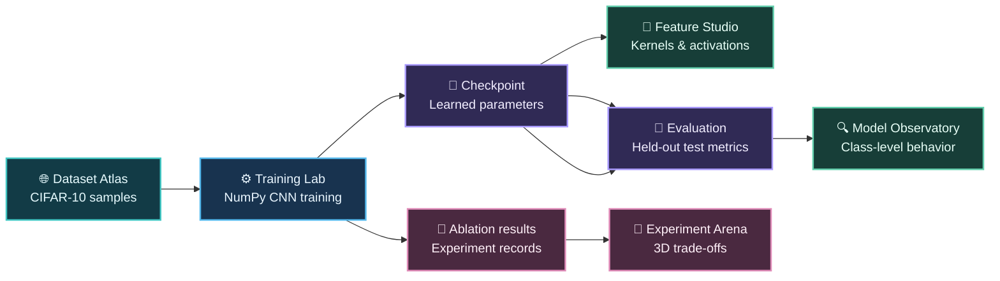

<div align="center">


<h1>Visual Feature Learning</h1>

<p><strong>A 3D-first lab for seeing how a NumPy CNN learns from CIFAR-10.</strong></p>

<p>
  
  
  
  
</p>

<p>
  <a href="#quick-start">Quick start</a> ·
  <a href="#explore-the-lab">Explore the lab</a> ·
  <a href="#how-the-learning-journey-fits-together">Learning flow</a> ·
  <a href="#project-map">Project map</a>
</p>

</div>

---

> [!TIP]
> 🩵 **The idea:** don’t settle for ~~another static score dashboard~~—rotate
> the model’s architecture, inspect its learned filters, follow its
> activations, and explore where its predictions succeed or stumble.

<p>
  <span style="background-color:#123b46;color:#e7fbff;padding:4px 9px;border-radius:6px"><strong>LAB NOTE</strong> · Learn by exploring the model, not just reading its final score.</span>
  <span style="background-color:#302a55;color:#f1edff;padding:4px 9px;border-radius:6px"><strong>VISUAL CODE</strong> · Cyan · teal · violet · rose</span>
</p>

This project implements a two-stage convolutional neural network **from
scratch with NumPy** and trains it on the official CIFAR-10 dataset. Its
Streamlit app turns the model into an interactive learning space: all app
charts and image-like model visualizations are **3D**. Text, controls,
performance metrics, and exact-value tables complement the visualizations.

### Reading the visual language

The README uses **bold** for key ideas, *italics* for emphasis,
<ins>underline</ins> for an important direction, and ~~strikethrough~~ to
contrast the old static-dashboard approach with this interactive lab.
🧭 Emojis identify the pages, while the colored labels above highlight
important notes in **deep teal and violet**, not neon yellow.

<p align="center">
  <strong>Pixels</strong> <em>→</em> <strong>Features</strong> <em>→</em>
  <strong>Predictions</strong> <em>→</em> <strong>Understanding</strong>
</p>

## Quick start

### 1 · Set up the environment

Use Python **3.10 or newer**. From the repository root, create and activate a
virtual environment:

```powershell
python -m venv .venv
.\.venv\Scripts\Activate.ps1
python -m pip install --upgrade pip
python -m pip install -r requirements.txt
```

`requirements.txt` includes the dashboard, scientific Python stack, and
TensorFlow's Keras dataset loader. **TensorFlow only downloads CIFAR-10**;
the CNN layers, forward/backward pass, and training logic are implemented
with NumPy.

### 2 · Open the lab

```powershell
streamlit run app/streamlit_app.py
```

Streamlit prints a local URL in the terminal. Open it in your browser to enter
the **Control Room**.

### 3 · Train and evaluate

From the project root, run:

```powershell
python scripts/train.py
python scripts/evaluate.py
```

The configured baseline trains for 20 epochs on CIFAR-10. The first dataset
load may download CIFAR-10 and requires an internet connection. Training time
depends on the machine; the pure-NumPy implementation may take a while.

**Already have a checkpoint?** Skip training and run evaluation to generate
the report used by the Model Observatory.

## Explore the lab

| Page | Your mission |
|:--|:--|
| 🧭 **Control Room** | Get oriented, inspect the network architecture in 3D, and check which model artifacts are ready. |
| 🌐 **Dataset Atlas** | Explore CIFAR-10 pixels in RGB color space and compare class-level color signatures. |
| ⚙️ **Training Lab** | Launch the baseline, review its training output, and rotate the 3D epoch trajectory. |
| 🧬 **Feature Studio** | Inspect learned kernels, channel connections, predictions, and 3D activation surfaces. |
| 🔭 **Model Observatory** | Explore class confusions and per-class accuracy on the held-out test set. |
| 🧪 **Experiment Arena** | Compare ablations across model size, test accuracy, and training time. |

<details>
<summary><strong>What does “3D-only visuals” mean here?</strong></summary>

The Streamlit app uses interactive 3D Plotly figures for charts and
image-like/model visualizations—such as point clouds, surfaces, and network
structures. Rotate, zoom, and hover to inspect them. **Text, controls, metric
cards, and tables are retained** so the experience stays informative and
usable rather than becoming a wall of graphics.

</details>

## How the learning journey fits together



<ins>Follow the arrows from raw images to model understanding.</ins> The
Dataset Atlas can be explored independently; training unlocks learned
features, while evaluation creates the class-level report.

## Under the hood

The baseline takes RGB images in **32 × 32** resolution, normalizes them, and
passes them through two convolution / ReLU / max-pooling stages before a
dense classifier produces **10 class logits**.

```text
RGB image (3 × 32 × 32)
  → Conv 3 → 16, ReLU
  → MaxPool 2 × 2
  → Conv 16 → 32, ReLU
  → MaxPool 2 × 2
  → Flatten (2,048 features)
  → Dense 2,048 → 10 logits
```

The implementation uses NCHW tensors inside the model. CIFAR-10 images arrive
as uint8 NHWC arrays and are scaled, channel-normalized, and converted during
preprocessing. Model architecture and run settings are defined in
`configs/cifar10_baseline.json`.

### Visualization palette

The app and this README use a cool, high-contrast palette—**deep navy, cyan,
teal, violet, and rose**—to distinguish data, model stages, and experiments.
No neon-yellow accent is needed to make the important signals stand out.

## Artifacts and outputs

Training and evaluation create local artifacts:

| Artifact | Default location | Used for |
|:--|:--|:--|
| Training history | `outputs/cifar10_baseline/training_history.json` | Epoch metrics and the Training Lab trajectory |
| Training log | `outputs/cifar10_baseline/training.log` | Run output in the Training Lab |
| Evaluation report | `outputs/cifar10_baseline/final_metrics.json` | Test metrics and Model Observatory views |
| Model checkpoint | `checkpoints/cifar10_baseline/cifar10_cnn_latest.npz` | Learned model weights for feature exploration |
| Ablation results | `outputs/ablation_studies/results.json` | Experiment Arena comparison |

Generated datasets, checkpoints, and run outputs are excluded by `.gitignore`.
They are not needed to install the code, but the relevant artifacts must exist
to unlock their corresponding app views.

## Project map

```text
app/
├── streamlit_app.py             # Streamlit entry point, shared theme and navigation shell
├── navigation.py                # Page definitions and sidebar groups
├── theme/
│   └── styles.css               # Shared dark visual theme
├── components/
│   ├── page_header.py           # Reusable page title and introduction
│   ├── status_panel.py          # Training/checkpoint/evaluation readiness
│   └── empty_state.py           # Helpful missing-artifact states
├── services/
│   ├── artifacts.py             # Artifact locations and freshness checks
│   └── training_runner.py       # Launch training and read its log
└── pages/
    ├── 0_control_room.py        # Welcome, model overview and readiness
    ├── 1_dataset_atlas.py       # CIFAR-10 RGB space exploration
    ├── 2_training_lab.py        # Training controls and learning trajectory
    ├── 3_feature_studio.py      # Kernels, sample predictions and activations
    ├── 4_model_observatory.py   # Confusion and per-class evaluation views
    └── 5_experiment_arena.py    # Ablation trade-off comparison

src/
├── data/                        # CIFAR-10 loading and preprocessing
├── inference/                   # Reusable single-image prediction API
├── layers/                      # NumPy convolution, pooling and activation layers
├── models/                      # CNN definition and model configuration
├── training/                    # Training loop, optimizer and loss
├── evaluation/                  # Metrics and confusion matrix calculations
└── visualization/               # Reusable Plotly 3D figure builders

scripts/
├── train.py                     # Train and save the baseline
└── evaluate.py                  # Evaluate a saved checkpoint

tests/                            # Unit, pipeline, inference and 3D-visualization tests
configs/
└── cifar10_baseline.json        # Dataset, architecture, training and artifact settings
docs/
└── assets/
    └── typing-lab.svg           # Local animated README header
```

## Run the checks

Install development tools with the project extras:

```powershell
python -m pip install -e ".[dev,datasets]"
python -m pytest
python -m ruff check .
```

## Project notes

- **Dataset:** CIFAR-10, official 50,000-image training split and 10,000-image test split.
- **Model:** two-stage CNN implemented in NumPy.
- **Dashboard:** Streamlit with interactive Plotly 3D visualizations.
- **Python:** 3.10+.
- **License:** MIT. See [`LICENSE`](LICENSE).

<div align="center">

*Built to make feature learning visible—one tensor, one filter, one prediction at a time.* 🩵

</div>